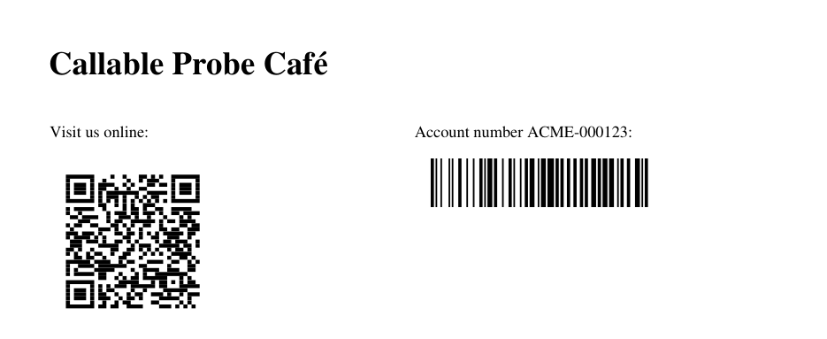

# Barcodes and QR codes for S-Docs templates

Add **QR codes** and **Code128 barcodes** to existing S-Docs templates. Nothing in the S-Docs package changes and nothing extra is installed:
- **How:** four Apex classes plug into S-Docs' [callable Apex](https://kb.sdocs.com/knowledge-base/sdocs/applying-logic/call-apex-classes-in-your-s-docs-templates/) feature. The template calls the class, and the class returns the symbol as HTML.
- **Why HTML tables:** the S-Docs PDF renderer can't draw `data:` images or SVG, so the symbol is drawn as tables.
- **No outside dependencies:** no images, files, static resources or external services.



*A PDF generated from [`examples/account-barcodes.html`](examples/account-barcodes.html), with a QR code from the Account's Website and a Code128 barcode from its AccountNumber.*

## What's in the repo

| Path | What it is |
|---|---|
| `force-app/main/default/classes/SDocsBarcodeCallable.cls` | The class templates call: `global`, implements `Callable`. Actions `qr` and `code128` |
| `force-app/main/default/classes/SDocsBarcodes.cls` | Code128 encoder (all of ASCII, code sets A/B/C) and the HTML drawing for both symbologies |
| `force-app/main/default/classes/SDocsQrEncoder.cls` | QR encoder (ISO/IEC 18004): byte mode (UTF-8), error correction L/M/Q/H, versions 1–40 |
| `force-app/main/default/classes/SDocsBarcodeCallableTest.cls` | 21 tests, 98–100% coverage of the three classes |
| `examples/account-barcodes.html` | A complete template body to paste into an Account template |
| `scripts/try-callable.apex` | A smoke test that calls the class without a template |

## Deploy

You need the [Salesforce CLI](https://developer.salesforce.com/tools/salesforcecli) (`sf`) and an org with S-Docs installed. Deploy to a sandbox first.

1. Clone the repo and log in to the org:

   ```bash
   git clone git@github.com:s-docs/sdocs-barcode-callable.git
   cd sdocs-barcode-callable
   sf org login web --alias my-org          # add --instance-url https://test.salesforce.com for a sandbox
   ```

2. Deploy the classes and run their tests. Production deploys need the tests:

   ```bash
   sf project deploy start --source-dir force-app --target-org my-org --test-level RunSpecifiedTests --tests SDocsBarcodeCallableTest
   ```

   To check a production deploy without deploying, run `sf project deploy validate` with the same arguments.

3. Optional smoke test. It prints the size of a QR code's HTML and an example error marker:

   ```bash
   sf apex run --target-org my-org --file scripts/try-callable.apex
   ```

No permission sets are needed:
- **Who it runs as:** the class runs as the user generating the document.
- **Sharing and security:** it reads the record with `with sharing` and user-mode SOQL, so it sees exactly the fields that user can see.

**Without the CLI,** you can add the four classes another way. Use a change set, or create each class in **Setup → Apex Classes → New** and paste its source. Create them in this order, because each depends on the one before: `SDocsQrEncoder`, `SDocsBarcodes`, `SDocsBarcodeCallable`, then `SDocsBarcodeCallableTest`.

## Add a barcode to an S-Docs template

1. Open the template in the S-Docs template editor and switch to the **Source** view.
2. For each symbol, add a callable block. **Keep each block on one line.** Here `field` is the field to encode on the template's base record, and `key` names the merge field the symbol is returned in:

   ```html
   <!--<callable><class>SDocsBarcodeCallable</class><action>qr</action><args>{"field":"Website","key":"websiteqr","module":"3pt"}</args></callable>-->
   ```

3. Put the key where the symbol should appear, in **triple braces**, because the value is HTML:

   ```html
   {{{!websiteqr}}}
   ```

4. Save and generate the document.

### Full example (Account template, PDF)

From [`examples/account-barcodes.html`](examples/account-barcodes.html):

```html
<!--<callable><class>SDocsBarcodeCallable</class><action>qr</action><args>{"field":"Website","key":"websiteqr","module":"3pt","level":"M"}</args></callable>-->
<!--<callable><class>SDocsBarcodeCallable</class><action>code128</action><args>{"field":"AccountNumber","key":"accountbarcode","module":"1.2pt","height":"36pt"}</args></callable>-->
<!--<callable><class>SDocsBarcodeCallable</class><action>qr</action><args>{"field":"Owner.Email","key":"ownerqr","module":"2.25pt","onerror":"blank"}</args></callable>-->
<h1>{{!Account.Name}}</h1>
<table style="width: 100%; border-collapse: collapse">
  <tr>
    <td style="width: 50%; vertical-align: top">
      <p>Visit us online:</p>
      {{{!websiteqr}}}
    </td>
    <td style="width: 50%; vertical-align: top">
      <p>Account number {{!Account.AccountNumber}}:</p>
      {{{!accountbarcode}}}
      <p>Account owner:</p>
      {{{!ownerqr}}}
    </td>
  </tr>
</table>
```

**Other base objects** work the same way. Use field paths from the template's base object:
- **Opportunity:** `"field":"Account.AccountNumber"`
- **Invoice object:** `"field":"Payment_Link__c"`

### Arguments

Every argument is a JSON string inside `<args>`.

| Argument | Meaning | Default |
|---|---|---|
| `field` | **Recommended.** Path of the value on the template's record: `Name`, `Account.AccountNumber`, `Owner.Email`, up to 5 lookups. Read with SOQL as the generating user, so the value is exactly what's stored | – |
| `value` | The text itself, usually a merge field: `"{{!Opportunity.Name}}"`. Only for simple text; see [Caveats](#caveats) | – |
| `key` | The merge field name the symbol is returned in. Use a **different, lowercase** key for every symbol in the template | `qrcode` (QR) / `barcode` (Code128) |
| `module` | Size of one module (the smallest square or bar) in `pt`, `px`, `mm` or `in` | QR `3pt`, Code128 `1pt` |
| `height` | Code128 only: bar height | `40pt` |
| `level` | QR only: error correction `L` (7%), `M` (15%), `Q` (25%) or `H` (30%) | `M` |
| `onerror` | What to draw when a value can't be encoded: `marker` (a small red note saying why) or `blank` (nothing) | `marker` |

S-Docs adds `recordId` (the template's record) itself, so don't pass it.

**An empty value draws nothing,** for example a blank field or a missing parent record. **A value that can't be encoded never fails the document.** Instead the symbol is replaced by a marker, or nothing with `onerror=blank`, and the rest of the document generates normally. The marker says why:
- **Code128:** the value has a non-ASCII character such as `é`.
- **QR:** the value is too long.
- **Bad arguments:** an unknown level, a bad module size, or a field that doesn't exist or that the user can't see.

## Sizing guidance

These come from rendering a 39-symbol probe through the same PDF renderer and decoding it at 300 down to 72 dpi, with and without blur:

| | Code128 | QR |
|---|---|---|
| **Minimum module** | **1pt** (0.35 mm). Use **1.2pt** for handheld scanners and cheaper printers. 0.75pt only for short values on laser printers | **2pt** (0.7 mm) |
| **Recommended** | 1.2pt, bar height 36pt or more | 3pt, level M |
| **Exact sizes** (land exactly on the renderer's layout grid) | 0.75, 1.2, 1.5pt | 2.25, 3, 3.75pt |
| **Maximum value** | No fixed limit; the symbol must fit the page. About 11 modules per character, or 5.5 per digit in runs of 4+ digits, plus 20 modules of quiet zone | 2,953 bytes at L, 2,331 at M, 1,663 at Q, 1,273 at H. **In practice, keep it at or under about 1,000 bytes** |

How sizes and payloads behave:
- **Other sizes are snapped** to within 0.019pt of a size on the renderer's grid. Without snapping, the renderer's rounding drifts by up to half a module across a symbol.
- **Size of a QR code:** (modules + 8) × module size. For example, a 1,000-byte QR code at level M is version 25: 117 + 8 = 125 modules, which at 3pt is 375pt (5.2 in) wide.
- **Cost:** a 1,000-byte QR code takes about 0.4 s of Apex CPU, and the largest possible about 0.9 s. A typical short URL takes under 0.1 s.
- **Characters:** QR codes carry UTF-8 text, so any language works. Code128 carries ASCII only, including control characters such as tab.
- **Misreads:** for values where a silent misread would be costly (amounts, account numbers), prefer QR. Code128's single check character can let a misread through at the resolution limit.

## Caveats

**Use `field`, not merge fields, when the value comes from the record.** S-Docs substitutes the merge field into the `<args>` JSON text first and parses it afterwards. A merge value containing a **double quote or a backslash** makes S-Docs fail the **whole document** before this class runs (`Unexpected character …` or `Unrecognized character escape …`). Other characters arrive in S-Docs' internal escaping, which the class undoes:
- `<` and line breaks decode exactly.
- `&`, `'`, `$`, `%`, `€` and `ü` arrive unchanged.

`field` avoids all of this.

**Other things to know:**
- **Triple braces are required.** `{{!websiteqr}}` (double braces) renders nothing.
- **One block per line.** S-Docs only finds a callable block written on a single line. A block broken across lines is ignored, and the symbol is blank.
- **Don't write `<callable>` anywhere else in the template,** not even in a comment. S-Docs treats it as a block and the document fails with `Failed to parse XML … comment … was not closed`.
- **Leave the quiet zone clear:** the white margin around the symbol (10 modules each side for Code128, 4 for QR). Don't overlap it with borders or backgrounds.
- **Fixed colors:** symbols are black on white.
- **Not supported:**
  - GS1-128 (FNC1)
  - Data Matrix, PDF417 and EAN/UPC
  - the QR ECI header (some handheld scanners in keyboard mode assume Latin-1 and garble non-ASCII text; phone cameras assume UTF-8)
- **Output formats:** tested with **PDF** output. DOC/DOCX output and email-body templates haven't been tested.

## Troubleshooting

| Symptom | Fix |
|---|---|
| `<callable> error: Class not found: SDocsBarcodeCallable` | The classes aren't deployed, or `SDocsBarcodeCallable` isn't `global`. If your org has its own namespace prefix, use `<class>yourns.SDocsBarcodeCallable</class>` |
| The symbol is missing; nothing is printed | Use triple braces. Check that the key in `{{{!…}}}` matches `key` and is lowercase. Check that the callable block is on one line. The field may be blank |
| A small red note where the symbol should be | Read it: it says why (non-ASCII text for Code128, a value too long for QR, a bad argument, an unknown field) |
| The whole document fails with `Unexpected character` or `Unrecognized character escape` | A merge value passed as `value` contains `"` or `\`. Use `field` instead |
| The whole document fails with `Failed to parse XML … comment … was not closed` | The text `<callable>` appears outside a callable block, for example in a comment. Remove it |
| A scanner can't read it | Increase `module` (Code128 1.2pt or more, QR 3pt), print at 100% (not "fit to page"), and keep the quiet zone clear |

## How it works

S-Docs runs each callable block before merging fields:
1. It calls `SDocsBarcodeCallable.call(action, args)`, and the class returns `Map<String, String>{ key => html }`.
2. S-Docs puts that value in the merge data, where `{{{!key}}}` inserts it unescaped.

The HTML is a table per symbol row:
- **Code128:** one single-row table of bars.
- **QR:** one single-row table per module row, run-length encoded, with a 4-module quiet zone.

Cell widths are written in pt on the PDF renderer's layout grid (3/80 pt), so every module lands exactly where it should.

The encoders come from S-Docs' Live Edit 2.0 ("Aspen") engine work, where they were hardened and measured:
- an exact Code128 match with Apple's CoreImage reference symbol
- QR mask scoring checked against a plain reference implementation for all 8 masks
- a 39-symbol print probe decoded with macOS Vision

They were also tested end to end with legacy S-Docs templates generated through `DocumentSDK.generateDocument`. Every symbol from `field` arguments decoded to exactly the stored value.
